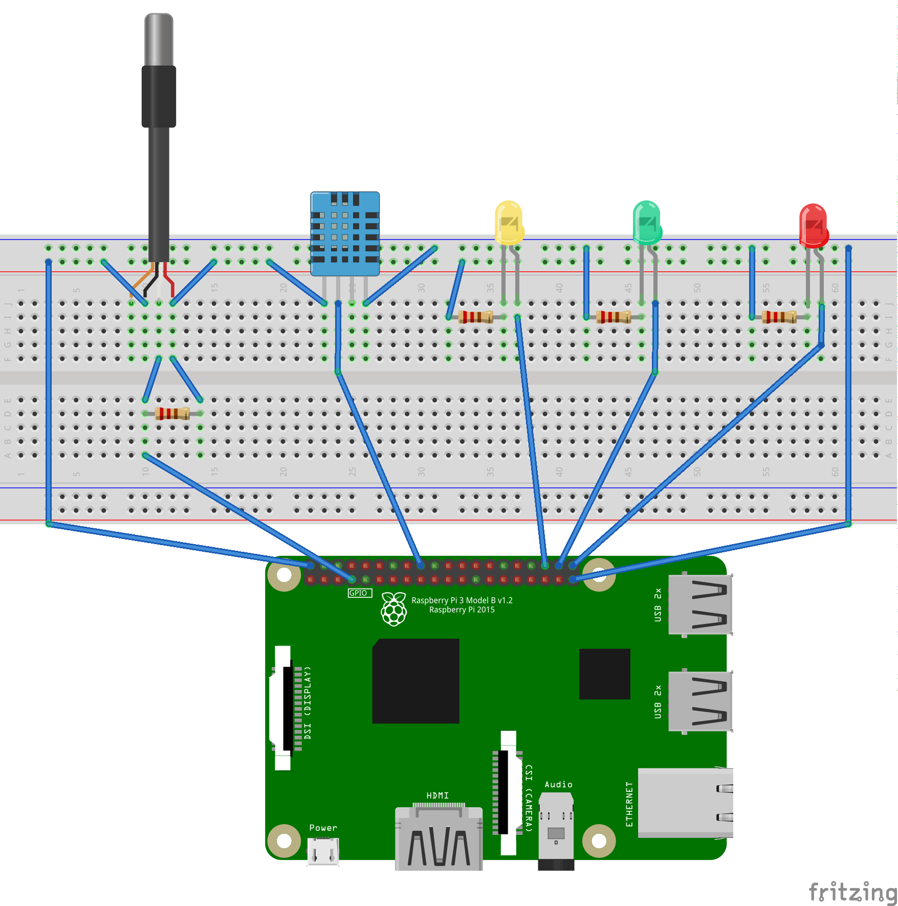

# iot-raspi-sensors

[](https://opensource.org/licenses/MIT)

IoT container for Raspberry Pi used to measure temperature and humidity.

For storing measurement data, it consumes [IoT server](https://github.com/mmontes11/iot) REST API via [IoT client](https://github.com/mmontes11/iot).

It also has a lightweight socket server for providing real time sensor data.

### Components

* [DHT11](https://www.adafruit.com/product/386)
* [DS18B20](https://www.adafruit.com/product/381)
* 1 x 4.7kΩ Resistor (DS18B20 data pull-up)
* 1 x 10kΩ Resistor (DHT11 data pull-up)
* 4 x 220Ω Resistor (LED current limiting)
* 3 x LED

### Raspberry Pi Configuration

Add the following line to `/boot/firmware/config.txt` (Pi 5) or `/boot/config.txt` (Pi 4/3/Zero) to enable the 1-Wire interface for the DS18B20 sensor:

```ini
dtoverlay=w1-gpio,gpiopin=19
```

After modifying `config.txt`, reboot the Pi:

```bash
sudo reboot
```

Verify the 1-Wire bus loaded and detected the sensor:

```bash
ls /sys/bus/w1/devices/
```

You should see an entry like `28-xxxxxxxxxxxx` (the DS18B20 serial ID) and `w1_bus_master1`. If you only see `w1_bus_master1`, the sensor is not being detected — check wiring and pull-up resistor.

### Sensor configuration

* [DHT11](https://www.raspberrypi-spy.co.uk/2017/09/dht11-temperature-and-humidity-sensor-raspberry-pi)
* [DS18B20](https://www.raspberrypi-spy.co.uk/2013/03/raspberry-pi-1-wire-digital-thermometer-sensor/)

### Wiring



### Environment Variables

| Variable | Description | Example |
|---|---|---|
| `IOT_RASPI_DHT_TYPE` | DHT sensor model (11 or 22) | `11` |
| `IOT_RASPI_DHT_GPIO` | GPIO pin for DHT11 data line | `5` |
| `IOT_RASPI_SUCCESS_LED_GPIO` | GPIO for success LED | `4` |
| `IOT_RASPI_ERROR_LED_GPIO` | GPIO for error LED | `18` |
| `IOT_RASPI_ACK_LED_GPIO` | GPIO for acknowledgment LED | `22` |
| `IOT_RASPI_LONGITUDE` | Pi location longitude | `-18.584655` |
| `IOT_RASPI_LATITUDE` | Pi location latitude | `63.213341` |
| `IOT_RASPI_TOPIC` | MQTT/topic identifier | `ramallal` |
| `IOT_RASPI_NODE_PORT` | Socket server port | `8080` |
| `IOT_RASPI_SOCKET_INTERVAL` | Socket push interval (ms) | `5000` |
| `IOT_SERVER_URL` | IoT server API URL | `https://iot.example.com/api` |
| `IOT_USERNAME` | IoT server username | `raspi` |
| `IOT_PASSWORD` | IoT server password | `raspi` |

### Troubleshooting

**DS18B20: `ENOENT: no such file or directory, open '/sys/bus/w1/devices/00-300000000000/w1_slave'`**

The `00-300000000000` ID is a ghost entry — the 1-Wire bus is active but no sensor responded. Causes:

1. **Missing or wrong pull-up resistor** — DS18B20 data line needs a 4.7kΩ resistor to 3.3V
2. **Wrong GPIO pin** — Ensure `gpiopin` in `config.txt` matches the actual data pin (default: GPIO19)
3. **Parasitic vs normal power mode** — If using normal 3-wire mode (VCC, GND, DATA), ensure all three are connected. For parasitic mode (2-wire), add `pullup=1`: `dtoverlay=w1-gpio,pullup=1,gpiopin=19`
4. **Faulty sensor or wiring** — Test with `cat /sys/bus/w1/devices/28-*/w1_slave`

**DHT11: `failed to read sensor`**

1. **Missing pull-up resistor** — DHT11 data line needs a 10kΩ resistor to 3.3V
2. **Read interval too short** — DHT11 requires ~2 seconds between readings
3. **Wrong GPIO** — Verify `IOT_RASPI_DHT_GPIO` matches the wired pin
4. **Container permissions** — The container runs with `privileged: true` to access GPIO. Ensure this is set in `docker-compose.yml`

### Development

```bash
$ npm start
```

### Lint

```bash
$ npm run lint
```

### Production

Configuration:
* Create a `.env` file like [this one](./.env.example).

```bash
$ ./run-pro.sh
```
